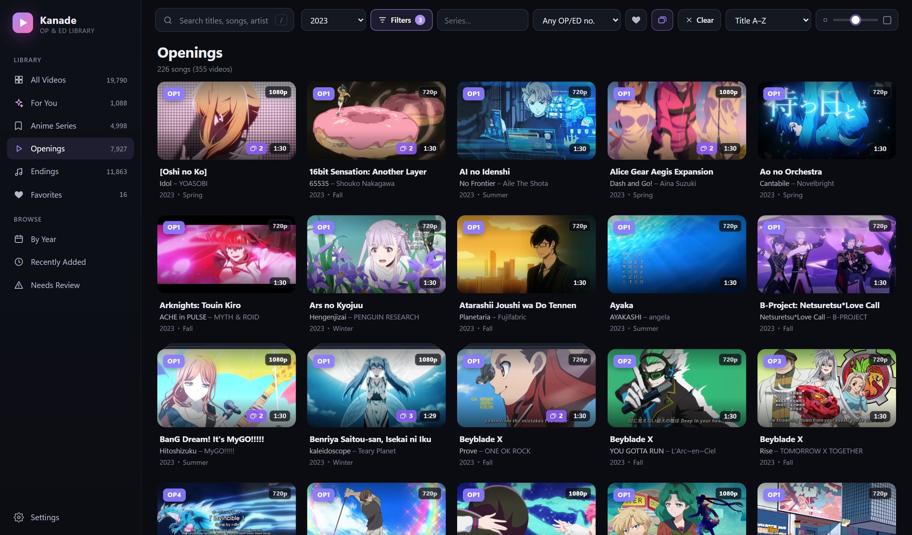
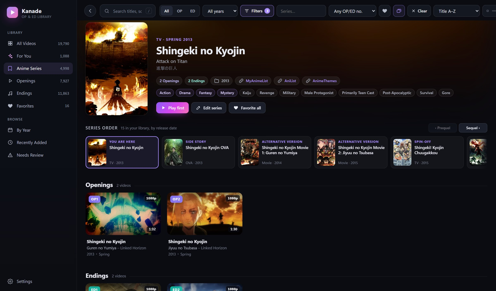
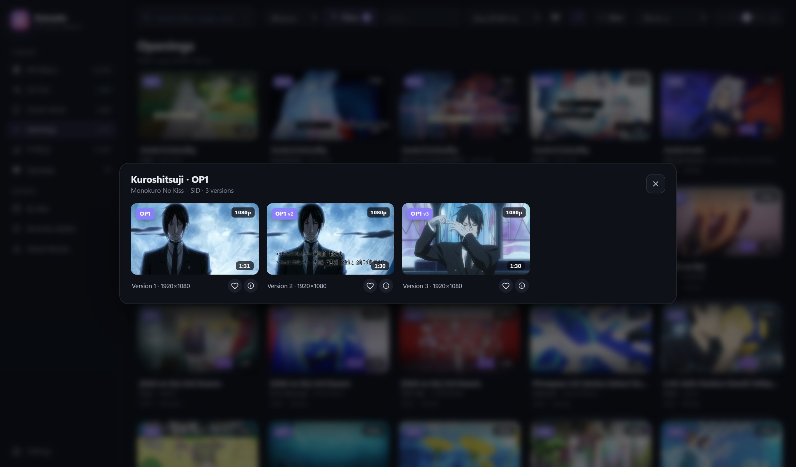

# Kanade: Anime OP/ED Library



A Windows desktop app that turns a folder of anime openings and endings (for example an
AnimeThemes-style archive organised as `2015\Spring\ShingekiNoKyojin-OP1.webm`) into a searchable,
visual catalogue with proper titles, song credits, cover art, favourites, one-click playback in VLC and
taste-based recommendations.

**Your archive is read-only to Kanade.** It never renames, moves, deletes or modifies a video or folder.
Everything it creates (database, thumbnails, covers, cache, logs) lives in its own data folder.

## Features

* **Automatic identification** of every file against the AnimeThemes catalogue (titles in romaji / English /
  Japanese, season, song title, artists, cover art), with AniList, MyAnimeList and an optional local LLM as
  fallbacks, and a review queue for anything uncertain.
* **Fast, virtualised grid** that stays smooth with tens of thousands of videos; hover previews; best-frame
  thumbnails; resolution badge on every card.
* **Versions grouped into stacks:** every version, resolution and creditless copy of one song is one card;
  double-click it to pick the version to play.
* **Series pages** with every opening and ending, plus sequels, prequels and related series (from AniList).
* **Search and filters:** full-text search over titles, songs and artists; filters by OP/ED, year, season,
  format, genre, tag, quality and content rating.
* **For You:** learns your taste from folders of openings you love, your favourites and 👍 / 👎 ratings, and ranks
  the whole library by it (sound, look and genre; runs locally on your GPU or CPU). Every song is also typed by its
  own sound as Intense, Energetic, Mellow or Calm. See
  [RECOMMENDATIONS.md](RECOMMENDATIONS.md).
* **Corrections that stick:** edit any title, song or assignment; your edits always win over automatic data.
* **Offline first and private:** after the first setup it needs no internet; nothing about your library or
  taste leaves your computer.

<table>
<tr>
<td width="50%"></td>
<td width="50%"></td>
</tr>
<tr>
<td align="center"><sub>Series page with the whole franchise in release order</sub></td>
<td align="center"><sub>Every version of a song in one stack</sub></td>
</tr>
</table>

## For You: recommendations that learn your taste

Point Kanade at a folder (or several) of openings and endings you love, and **For You** ranks your whole library
by how well each song fits that taste. Everything runs on your own computer; nothing about your taste is sent
anywhere.

* **It listens and looks.** Every video is analysed once by AI models running locally: a music model (MERT) for
  rhythm, timbre and harmony, a music-and-language model (CLAP) for style, an image model (SigLIP 2) for the look
  of the animation, plus the anime's genres, tags and era, and who sings it.
* **It learns from you.** A small model is trained on your liked folders, favourites and 👍 / 👎 ratings, in about
  a second, whenever you've rated a few songs. A 👎 hides the song immediately and teaches For You to avoid songs
  like it; mistakes are undone completely by removing the rating.
* **It finds your liked songs in your library.** Liked videos from anywhere (other folders, other sources) are
  matched by name and confirmed by sound to the library copy of the same opening, so it learns from the right
  file.
* **Teach For You** plays your current top picks one by one, with sound, for quick 👍 / 👎: the fastest way to
  sharpen it. With a song type selected (e.g. Calm), it plays the top picks of that type.
* **Song types:** every song is labelled Intense, Energetic, Mellow or Calm from its own sound (an AudioSet
  classifier), and For You shows your best matches of each type. The number on a type chip is how many of your
  liked songs are of that type.
* **History:** pick an earlier time from the menu next to *Teach For You* to see For You as it was before you
  rated more songs, then *Back to latest*.
* **Accurate:** in a held-out test on a real library, liked songs the model had never seen landed at the 97th
  percentile (median), and about 60 % of them in the top 5 %. Details in [RECOMMENDATIONS.md](RECOMMENDATIONS.md).

## Requirements

* **Windows 10 or 11** (64-bit), or **Linux** (64-bit; checked on Ubuntu). macOS should work from source but is untested.
* [VLC](https://www.videolan.org/) for playback (optional on Linux: without it the system's default player is used)
* [FFmpeg](https://ffmpeg.org/) for thumbnails, durations and analysis (see below)
* Windows: the Microsoft Edge WebView2 runtime (part of Windows 11). Linux: the window uses Qt WebEngine, which
  `run.sh` installs with pip (no system packages needed)
* To run from source or build: Python 3.10 or newer (3.12 recommended)
* For You (optional): about 8 GB of free disk space for the analysis engine and its AI models; an NVIDIA
  graphics card makes the analysis much faster but isn't required

## Quick start

### Option A: the packaged app
0. Get the code: `git clone https://github.com/Ubaida-M-Yusuf/Kanade` (or download the ZIP from GitHub).
1. Run `dist\Kanade\Kanade.exe` (build it with `build.bat`, see below).
2. On first run a welcome window asks for your library folder (for example the folder that contains `2008\`,
   `2009\`, `90s\` and so on), then offers the optional For You download (AI engine and models, about 3–6 GB,
   with a progress bar). "Not now" is fine: For You asks again, with the same window, the first time you open it.
3. Kanade scans the folder, downloads the AnimeThemes catalogue (about 4 minutes) and identifies every file.
   Thumbnails are generated in the background. You can browse while that runs.
4. For You: the first time you open it, pick one or more folders of openings you love. *Settings ▸ For You*
   lists the AI models (what each does, size, downloaded or not) and can download anything missing. Nothing is
   ever downloaded without asking.

### Option B: run from source
Requirements: Python 3.10+ and FFmpeg (plus the WebView2 runtime on Windows 10).

Windows:

```bat
run.bat
```

Linux (or macOS):

```sh
sudo apt install python3-venv ffmpeg vlc     # Debian / Ubuntu; use dnf, pacman or brew elsewhere
./run.sh
```

The first run creates `.venv` and installs `requirements.txt`. If no window can open (for example on a server),
use `./run.sh --browser` to use Kanade in your web browser instead. Useful flags:

| Flag | Effect |
|---|---|
| `--browser` | open the UI in your default browser instead of a window |
| `--headless --port 8765` | only run the local server |
| `--no-scan` | skip the automatic incremental scan at startup |
| `--debug` | enable WebView developer tools |

Console tools (from source):

```bat
.venv\Scripts\python cli.py sync-catalog   & rem download the AnimeThemes catalogue
.venv\Scripts\python cli.py sample 20      & rem identify 20 random files into a throw-away DB and print a table
.venv\Scripts\python cli.py scan           & rem full scan with console progress
.venv\Scripts\python cli.py stats          & rem match statistics
.venv\Scripts\python cli.py review         & rem list Needs Review items
```

### FFmpeg
FFmpeg is used for thumbnails and durations. If it's missing, Kanade says so in the sidebar and in Settings.
Install it with:

```bat
winget install Gyan.FFmpeg
```

Alternatively, put `ffmpeg.exe` and `ffprobe.exe` in a folder named `ffmpeg` next to `Kanade.exe`, or set their
paths in `config.json`. `build.bat` copies them from your PATH into `dist\Kanade\ffmpeg\` automatically.
FFmpeg is a separate program under the LGPL/GPL licence and is distributed alongside Kanade, not inside it.

---

## Using the app

| Action | How |
|---|---|
| Play in VLC | double-click a card (never opens the details panel), or select it and press **Enter**. A single click opens the panel after a short pause, so a double-click can't trigger it |
| Filters | the **Filters** button: *Type & season* (TV, Movie, OVA, ONA, Special, TV Short, Game, Visual Novel; Winter–Fall), *Genres* and *Tags* (Any / All), *Quality & more* (1080p / 720p / lower, original versions only, with lyrics/subtitles). Active filters appear as removable chips under the title; **Clear** resets everything. Clicking a genre pill on a series page also filters |
| Details panel | single click (never starts playback) |
| Search | type anywhere after pressing **/**; e.g. `bocchi op1`, `attack on titan`, `LiSA`, `進撃`. The small **×** in the search box (and in the *Series…* box) clears it; so does **Esc** |
| Seasons and related series | on a series page, **Series order** lists every related entry in your library (sequels, prequels, side stories, movies, spin-offs...) by release date, with *You are here* on the current one. **‹ Prequel** / **Sequel ›** flip straight to the neighbouring season. Related entries you don't have (of the whole franchise, the same from every series of it, each saying what it relates to, e.g. "Sequel · of X") are shown dimmed; click one to open it on MyAnimeList or AniList. The ‹ › buttons scroll the strip; each entry is labelled from AniList (Prequel, Sequel, Later sequel, Earlier prequel, Side story, Recap…), so the story order is clear even though the strip is in release order |
| For You | the sidebar view that ranks the library by your taste (see [RECOMMENDATIONS.md](RECOMMENDATIONS.md)). Tabs: **For you** (songs you haven't rated yet), **Liked** (likes, favourites and songs from your liked folders, newest first: *Date liked* uses the moment you liked or favourited it, or the date of the file in your liked folder), **Hidden** (dislikes, with *Unhide*; sorted by *Date disliked*, newest first). New results appear the next time you open For You (or via *Show* in the header), never while you're looking at it; the scroll position is kept when nothing changed. The history menu shows earlier rankings. Under the title, *Learned from … + N liked files not in your library* opens a list of liked-folder files that have no copy in your library (soundtracks, promo videos, insert songs…), each with **Play** and **Show in folder** |
| Match badge | every card that For You has analysed shows how well it fits your taste (%), in every view: All Videos, series pages, search |
| Like / dislike | hover a card and press 👍 / 👎 (or select it and press **L** / **D**, or right-click). A like or dislike applies to the whole song (all its versions). Disliked songs leave For You at once; Kanade learns from ratings in a few seconds, after 5 new ratings, 30 s without one, or when you leave For You. **Undo** is in the toast |
| Versions | every version / resolution / creditless copy of one song is grouped into one stacked card with a count badge (⧉ 3). One click opens the details panel like any card; **double-click** (or click the ⧉ badge) shows all versions with their thumbnails, resolution and tags. In that pop-up, click to select a version and double-click to play it in VLC (ⓘ shows its details). The stack button in the toolbar turns grouping off |
| Resolution | top-right badge on every card (4K, 1080p, 720p, 480p...) |
| Series page from a video | **Open series** in the details panel, or right-click ▸ *Open series page* |
| Series in its own window | right-click a card (or a series poster) ▸ *Open series in a new window*: a separate window with its own filters and selection, so the main window stays where it was. Likes, favourites and settings changed in one window show up in the others within seconds; a series window never changes the saved view preferences (card size, stacking, song type), and filters are never saved, so the app always starts unfiltered |
| Game & visual-novel openings | the AnimeThemes archive's `misc` videos (game and visual-novel openings) aren't linked to a series in the AnimeThemes catalogue. Kanade ships their identifications (`kanade/data/known_videos.json`): an exact copy of one of those files (same name and size) that is still unidentified is identified automatically, so it doesn't land in Needs Review. Videos you identified or corrected yourself are never changed |
| Ecchi / 18+ / gore | *Filters ▸ Content* hides or shows suggestive, adult and gore / horror series. Marks are combined from AniList (genres, tags, adult flag), Kitsu (age ratings), AnimeThemes (NSFW videos) and, optionally, MyAnimeList (genres and themes such as Ecchi, Gore, Horror). Each source can only add a mark; cards show *Ecchi*, *18+*, *Gore* or *Horror* |
| My MyAnimeList list | paste your MyAnimeList profile link (or name) in *Settings ▸ MyAnimeList*. Kanade reads your **public** anime list (no client ID needed) and refreshes it every few hours; *Filters ▸ My list* then shows only series you're **Watching**, have **Completed**, have **On hold**, **Dropped**, **Plan to watch**, or that are **Not on your list** (tick any mix). Works on every page, For You included |
| MyAnimeList (optional) | paste your own MyAnimeList API client ID in *Settings ▸ MyAnimeList* (myanimelist.net ▸ Account Settings ▸ API ▸ Create ID). Kanade then adds MyAnimeList's genres and themes to every series in the background (about 0.4 s per series, saved as it goes; each series is fetched once, and only an incomplete answer, e.g. a show that hasn't aired yet, is asked again a month later); they are added next to the AniList genres, never replacing them. The ID stays in your local settings |
| Favourite | hover a card and click ♥, or press **F** (favourites also count as likes for For You) |
| Multi-select | **Ctrl**+click, **Shift**+click, **Ctrl+A** (select all in the current view, e.g. For You ▸ Liked), or press on an empty spot and **drag a box** over cards (hold **Ctrl** to add to the selection; the list scrolls when you reach the edge) |
| Songs by an artist | click a singer or band name (on a card or in the details panel), or right-click ▸ *More by …*: every opening and ending they sang, across all series. The *Artist* chip under the title removes the filter |
| Copy to a folder | right-click ▸ *Copy to a folder…* (or the *Copy to folder…* button when several are selected). Before copying, Kanade shows the size, the free space and any names that already exist there: those files get a number (`Name (2).webm`); nothing is ever overwritten. Files are copied to a hidden temporary name and only get their real name once complete, so quitting or a crash never leaves a broken file. Copying into the library folder itself is refused |
| Edit metadata | right-click ▸ *Edit metadata*, or press **E** |
| Arrow keys | move the selection; **Esc** closes panels |

Sidebar views: All Videos, Anime Series (cover-art grid; click a series to see its Openings and Endings from every
year folder), Openings, Endings, Favorites, By Year (mirrors your folders, with season sub-sections),
Recently Added and Needs Review.

Right-click a card for **Play**, **Open series page**, **Show all versions**, **View details**, **Open containing
folder** (selects the file in Explorer), **Like** / **Dislike**, **Edit metadata** and **Add/remove favourite**.

Hovering a card for half a second plays a muted preview of the video (you can turn this off in Settings).

---

## How identification works

Files are matched in this order. Every match stores its **source** and a **confidence** score.

1. **AnimeThemes, exact file (confidence 1.00).** Kanade mirrors the whole AnimeThemes catalogue
   (`https://graphql.animethemes.moe/`, about 5,000 anime and 20,000 videos) into its database. Archive
   filenames are AnimeThemes video basenames, so most files match exactly and offline: the main romaji title,
   English and Japanese titles, synonyms, season/year, MAL and AniList IDs, cover art, song title and artists.
   Files missing from the local copy are also looked up live by basename.
2. **AnimeThemes, same series (0.90–0.95).** If the exact file isn't listed but its filename prefix (for example
   `BocchiTheRock`) belongs to a known series, the video is attached to that series.
3. **Fuzzy title match** against the catalogue, using the de-camel-cased name (`BocchiTheRock` → `Bocchi The Rock`)
   with rapidfuzz, constrained to the year folder ±1.
4. **AniList** search, then **Jikan / MyAnimeList** search, scored the same way.
5. **Ollama (optional).** If a local Ollama server is running, it's asked for the probable title of still-ambiguous
   filenames, and steps 3–4 are retried. The app works fully without it.

Anything below the auto-accept threshold (default **0.85**) goes to **Needs Review** with its best suggestion.
Files in a `misc` folder, or with names ending in `VN` / `Game` (game and visual-novel openings), are never
auto-accepted from a fuzzy match.

The displayed title is the MyAnimeList-style romaji title that AnimeThemes uses. If Jikan is reachable,
*Settings ▸ Fetch official MAL titles & artists* stores the exact MyAnimeList title (which then wins) and
fills in artists that AnimeThemes doesn't list. AniList fills in missing English/Japanese titles after each scan.

All API calls are throttled (AnimeThemes and Jikan under their per-minute limits, AniList at about 28/minute),
retried with exponential backoff, and cached on disk, so re-runs and offline use work.

---

## Fixing Needs Review items and other corrections

* **Needs Review** lists every unconfident match. Select one to see the suggestion and its confidence, then
  **Accept** it, or **Find another…** to search.
* **Edit metadata** (right-click or **E**) has two tabs:
  * **Details:** romaji / English / Japanese titles and year/season for the *series* (applies to all its videos),
    and OP/ED type, number, version, year, song and artist for the *video*.
  * **Find & assign anime:** search the library and the offline catalogue, AnimeThemes, AniList or
    MyAnimeList, then click a result to assign the video to it.
* **Bulk corrections:** select many videos (Ctrl/Shift-click or Ctrl+A), then use the floating bar to favourite,
  accept suggestions, or *Edit / assign…* to move them all to one anime or set the type/year for all of them.
* Corrections are stored separately (`user_override`, `anime_override`) and **always win** over automatic data,
  including after rescans and catalogue updates. *Reset corrections* restores the automatic values.

---

## Thumbnails

Each video's thumbnail is the best of six keyframes taken between 16% and 76% of the video. All six come from a
single FFmpeg run per video (one file open, one decoder thread per seek point), which on a hard disk is about
twice as fast as six separate runs (measured 0.4 s per video with three parallel readers) and gives identical frames. Every candidate is
scored for colourfulness, contrast and detail. Dark fades, white flashes and flat title cards are penalised, so
vivid character and key-art shots win over credits and transitions (credits can still win occasionally).
When the selection method improves, existing thumbnails are upgraded in the background (new videos come first),
and the old thumbnail stays visible until its replacement is ready. While the For You analysis runs, it makes the
upgraded thumbnails itself from the same six frames it reads anyway (each file is read from the disk once for both).

Card size: use the slider at the right of the toolbar, the **+ / −** keys, or **Ctrl + mouse wheel** (five sizes).
The **Any OP/ED no.** menu filters by theme number, e.g. *OP/ED 1* shows every OP1 and ED1.

## Performance and resource use

Measured with a library of about 20,000 videos (about 5,000 series):

* **Virtualised grid:** only the visible rows exist in the page (about 30–40 cards, ~800 DOM nodes in total).
  A scroll step costs about 0.1 ms (1.8 ms worst case). Switching views or sorting 20,000 items takes 20–90 ms.
* **Incremental updates:** while thumbnails, durations and covers are generated, the window fetches only what
  changed (`/api/media-updates`) and redraws only the affected visible cards. It never re-downloads the library.
  The full list is served from an in-memory cache that is rebuilt only after real changes (scan, matching, edits).
* **Smooth scrolling:** cards avoid backdrop blur, hover previews pause while scrolling, scroll events are
  coalesced to one paint per frame, and polling slows down when the window is in the background.
* **Background work:** FFmpeg runs at *below-normal* priority with 2 threads per process, so playback and the UI
  keep priority. The worker count (Settings) controls the parallelism. Browsing never pauses background work (pages
  and thumbnails come from the app's own disk); only a video starting to play does, for a few seconds (15 s for
  VLC), so its first seconds load instantly from the archive disk.
* **Memory:** the backend uses about 50 MB when idle and about 150 MB during a full thumbnail run. After each job,
  the matching index is dropped, SQLite caches are shrunk (capped at ~8 MB per connection) and garbage is
  collected. The window's JavaScript heap is about 30 MB for the full library.
* **Nothing is lost when Kanade is closed or crashes:** thumbnails are saved within a second of being made (a
  thumbnail file is written to a temporary name and swapped in whole), content ratings and related series are saved
  every chunk, and the For You engine saves after every 8 videos. On quit, Kanade asks the engine to save and stop;
  if Kanade itself crashes, the engine notices and stops by itself. Everything continues where it left off at the
  next start, and leftovers of an interrupted thumbnail are cleaned up automatically.
* **Single instance:** only one Kanade runs per data folder. Launching it again (for example while a background scan
  runs with `--headless --exit-when-idle`) opens a window on the running instance instead of starting a second
  copy that would compete for the database.

## Rescans

New folders and files (for example a new `2027\` year) are picked up automatically: at every start, and every
30 minutes while Kanade is open (*Settings ▸ Check for new files every…*, 0 turns it off). New files that
aren't in the local AnimeThemes catalogue copy are looked up live, then get thumbnails and genres like the rest.

**Offline first.** Once the library is set up, Kanade needs no internet: a start with nothing new makes no
network requests at all (checked with the internet blocked). Online sources are asked only for something new: a new
video (identification, cover, genres, content rating, related series, each asked once per series), the one-time
For You engine install, or when you press a refresh button in Settings. The AI models run from disk.

Kanade runs an incremental scan at every start (or via *Settings ▸ Rescan library*):

* unchanged files (same path, size and modification time) are skipped;
* new or changed files are fingerprinted (size + SHA-1 of the first and last 64 KiB), probed and matched;
* a file that moved or was renamed keeps its record, favourite and corrections (matched by fingerprint);
* files that disappeared are flagged *missing* and hidden, never deleted;
* identical copies at several paths are linked as duplicates.

---

## Data, cache and settings

Everything lives in **`%LOCALAPPDATA%\Kanade\`** on Windows, **`~/.local/share/Kanade/`** on Linux (or
`$XDG_DATA_HOME/Kanade`) and **`~/Library/Application Support/Kanade/`** on macOS:

| Path | Contents |
|---|---|
| `config.json` | settings: archive root, VLC path, FFmpeg paths, Ollama URL/model, worker count, thumbnail width, sources |
| `library.db` | SQLite database (anime, themes, videos, favourites, corrections, AnimeThemes catalogue, FTS5 search index) |
| `thumbs\` | video-frame thumbnails (WebP, ~480 px wide; the most attractive of 6 keyframes, see below) |
| `covers\` | cached cover art (WebP) |
| `cache\http\` | cached API responses |
| `logs\kanade.log` | log file (rotating): network errors, unreadable videos and so on |
| `webview\` | window storage |
| `features.db` | For You: audio / visual embeddings, rankings, taste groups |
| `engine\` | For You analysis engine: its own Python environment and the AI models (~8 GB) |

Set the environment variable `KANADE_HOME` to use a different data folder. Delete `thumbs\` to regenerate
thumbnails, or `library.db` to rebuild the library from scratch (this loses favourites and corrections).

### Database schema (summary)

* `anime`: AnimeThemes id, MAL id, AniList id, romaji / MAL / English / Japanese titles, synonyms, year, season,
  format, cover, source.
* `theme`: anime, OP/ED, number, part, version, song title, artists, episodes.
* `video`: theme, anime, path, filename, year folder, season folder, size, mtime, fingerprint, duration,
  resolution, thumbnail, match source, confidence, status, suggestion, date added, missing flag, duplicate link.
* `favorite`, `rating` (like / dislike per video), `user_override` (per-video corrections), `anime_override`
  (per-series corrections).
* `taste_match`: liked-folder files matched by name to library videos of the same opening (For You).
* `cat_anime`, `cat_video`: local mirror of the AnimeThemes catalogue.
* `video_fts`: FTS5 index over titles, synonyms, songs, artists, filenames and OP/ED numbers.
* `v_video`: view that applies corrections on top of the automatic data.

---

## Building the app

```bat
build.bat
```

This produces `dist\Kanade\Kanade.exe` (a one-folder PyInstaller build: it starts instantly and keeps FFmpeg next
to it). The app itself is about 45 MB. A "full" FFmpeg build adds about 430 MB; use `build.bat --no-ffmpeg` to leave
FFmpeg out and use the one on your PATH instead. Copy the whole `dist\Kanade` folder anywhere; no Python install is needed. The WebView2 runtime is part of
Windows 11.

Linux / macOS: `./build.sh` produces `dist/Kanade/Kanade`. FFmpeg isn't bundled there; install it with the
package manager. The For You engine sets up its own Python environment the first time it is installed, so it
needs `python3` with the `venv` module (Debian / Ubuntu: `sudo apt install python3-venv`). With an NVIDIA graphics
card and its driver installed, the engine uses it automatically, as on Windows.

---

## Project layout

```
app.py                desktop entry point (local server + pywebview window)
cli.py                console tools
kanade/config.py      paths, config.json, logging
kanade/db.py          SQLite schema and helpers
kanade/parser.py      filename / folder parser
kanade/scanner.py     incremental, read-only archive scanner
kanade/catalog.py     AnimeThemes catalogue mirror
kanade/matcher.py     identification pipeline
kanade/sources/       AnimeThemes, AniList, Jikan and Ollama clients
kanade/net.py         throttled, cached HTTP with backoff
kanade/media.py       FFmpeg probe, thumbnails, cover cache
kanade/search.py      FTS5 search
kanade/library.py     listings, favourites, ratings, corrections, related series, playback
kanade/jobs.py        background pipeline and thumbnail worker pool
kanade/content.py     content marks: ecchi / 18+ / gore (AniList, Kitsu, AnimeThemes, MyAnimeList)
kanade/activity.py    steps background work aside while a video plays
kanade/recommend.py   For You engine install, supervision and results
kanade/tastematch.py  matches liked-folder files to library videos by name
kanade/analyzer/      For You analysis engine and taste model (runs in its own Python environment)
kanade/server.py      local HTTP API (127.0.0.1 only, per-session token)
kanade/ui/            HTML / CSS / JS front end
```

---

## Privacy

Kanade runs entirely on your computer. The UI talks to a local server bound to `127.0.0.1` with a per-session
token. Network requests go only to public metadata services (AnimeThemes, AniList, Jikan / MyAnimeList, Kitsu,
cover-art hosts), the Python package index and Hugging Face (one-time For You engine install), and a local
Ollama server if you enable it. Requests contain anime titles, IDs or video file names (to identify them), never
folder paths, ratings or anything about your taste. Your library database, thumbnails, ratings and analysis results stay in your data folder.

## Credits

* Catalogue and file naming: [AnimeThemes](https://animethemes.moe/) (Kanade is not affiliated with it).
* Metadata: [AniList](https://anilist.co/), [Jikan](https://jikan.moe/) / MyAnimeList, [Kitsu](https://kitsu.io/).
* AI models used by For You (downloaded from Hugging Face on install, under their own licences):
  [MERT-v1-95M](https://huggingface.co/m-a-p/MERT-v1-95M), [CLAP larger_clap_music](https://huggingface.co/laion/larger_clap_music),
  [SigLIP 2](https://huggingface.co/google/siglip2-base-patch16-224),
  [AST AudioSet](https://huggingface.co/MIT/ast-finetuned-audioset-10-10-0.4593).
* UI window: [pywebview](https://pywebview.flowrl.com/); fuzzy matching: [RapidFuzz](https://github.com/rapidfuzz/RapidFuzz).

## License

Kanade is licensed under the [Apache License 2.0](LICENSE). You may use, modify and share it, including
commercially, as long as you **credit the original work**: keep the copyright notice and the [NOTICE](NOTICE)
file with any copy or derived work, state what you changed, and credit "Kanade by
[Ubaida-M-Yusuf](https://github.com/Ubaida-M-Yusuf)" with a link to this repository.
